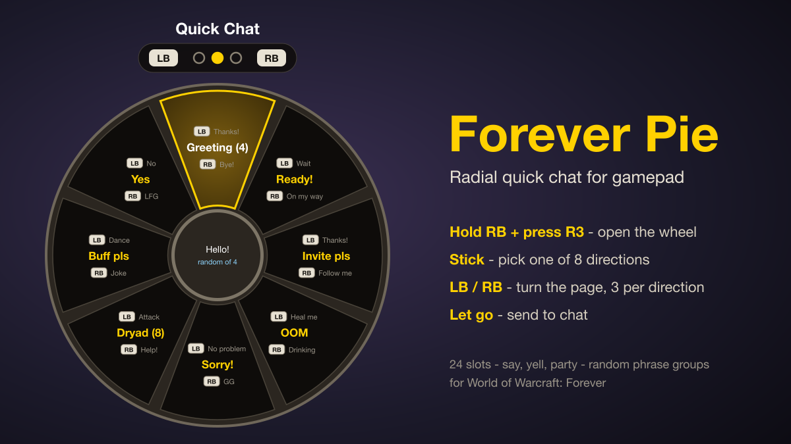

# Forever Pie

Radial quick chat for gamepad players in **World of Warcraft: Forever**. 24+ phrases on one wheel: 24 slots, and every slot can hold a whole group of random lines. Say hello, ask for a buff or call for help without reaching for a keyboard.

Category: **Chat & Communication**

## What it does

Hold **RB** and press **R3** (right stick click): a wheel opens in the middle of the screen, styled like the game's own gamepad menu, and stays open until you pick a phrase. Point the stick at one of 8 directions, let it go, and the phrase goes to chat. R3 without RB keeps its normal game action (ping).

Every direction holds **3 phrases**, so the wheel gives you 24 slots:

| Input | Phrase |
| --- | --- |
| nothing | the middle one (main page) |
| press **LB** | the top one (LB page) |
| press **RB** | the bottom one (RB page) |

All three are always visible in the segment. The one you are about to send is drawn large and bright, the other two stay small, so you never have to remember what is where.

## Features

- **Opens like a menu.** RB + R3 opens the wheel and it stays until you send or cancel. You can keep walking and using abilities meanwhile; R3 alone is left to the game, nothing is rebound.
- **24 slots** - 8 directions x 3 pages, paged with single presses of the bumpers like the tabs of the game's menu.
- **Phrase type per slot** - say, yell, party, raid, instance, guild or emote. A slot can simply follow the default channel, or always yell.
- **Random groups** - put several messages in one slot and a random one is sent each time. "Greeting" can be "Hi!", "Hello!" or "Salut!". The defaults include a group of Warcraft III Dryad lines as an example.
- **Emotes and commands** - a line can be a game command instead of text: `/dance` makes the character dance, `/cheer`, `/wave` and other emotes work too, as do slash commands of other addons. Commands mix with text in random groups.
- **Visual editor** - the settings page shows the same wheel; click a slot and edit its name, type and messages.
- **`%t`** in a message is replaced with your target's name, **`%q`** with a link to the quest in focus (the super-tracked one, else the first tracked): `Can you help with %q?`
- **Native look** - uses the game's own radial menu art and the button icons of your controller (Xbox, PlayStation, Switch).
- **Default phrase sets** in English, Russian, Ukrainian, French, Polish and Portuguese: pick one next to "Reset phrases".
- **Export / import** - save all your phrases as one line of text and paste it back later or on another character.
- English and Russian interface, following the game language.

## Controls

| Button | Action |
| --- | --- |
| Hold RB + press R3 | open the wheel |
| Right stick | point at a direction |
| LB / RB (press) | page left / right: LB page - main page - RB page, wrapping around |
| Let the stick go | send the highlighted phrase |
| R3 | drop the current pick; close the wheel when nothing is picked |
| B / Circle | close |

The wheel always opens on the main page.

The default channel and wheel scale can be changed in the settings.

## Settings

Open with `/fpie` or from Options - AddOns - Forever Pie.

- **Forever Pie** - default channel and wheel scale. On Auto, phrases go to the group chat while you are in a group and to Say otherwise; a phrase with its own type ignores this.
- **Phrases** - the wheel editor. Click a slot, then set:
  - **Name on the wheel** - short text shown in the segment;
  - **Type** - how the phrase is spoken;
  - **Messages** - one per line. More than one line makes a random group. A line like `/dance` runs the emote instead of sending text.

Slash commands:

- `/fpie` - open settings
- `/fpie toggle` - show the wheel for mouse testing (move to aim, scroll to switch phrase, click to send)
- `/fpie reset` - reset phrases to the defaults

## Editing the default phrases

Open `tools/phrase-builder.html` in a browser: it shows the Russian default phrase set laid out like the wheel. Edit or drag slots around, then copy the generated block into `DEFAULT_PHRASES.ruRU` in `ForeverPie/Locale.lua`. The Russian set is the source: the other five languages are translated from it.

## Install

Copy the `ForeverPie` folder into `World of Warcraft/_forever_/Interface/AddOns/` and restart the game or `/reload`.

## Notes

- While the wheel is open only its own buttons (B, LB, RB, R3) and the aiming stick are taken from the game, so the camera stays put; movement and everything else keep working.
- The game does not let addons block a button during combat, so in combat RB + R3 opens the wheel and the game's own R3 action (ping) runs as well, the wheel's buttons (B, LB, RB) also do their normal game action, and the camera turns while you aim.
- Say, yell and emote are sent on a real button press or release, as the game requires.
- Secure commands (`/cast`, `/use`, `/target` and other macro-only commands) cannot be run by addons, so they do not work in a slot.

## Say thanks

If you like the addon and want to thank the author, send some coins in game :) Europe, WoW Forever, PvE realm, character **Zelda Highblood**.

## Русский

Радиальный быстрый чат для геймпада в **World of Warcraft: Forever**. От 24 фраз на одном колесе: 24 слота, и в каждом может лежать целая группа случайных реплик. Поздоровайтесь, попросите бафф или позовите на помощь, не дотягиваясь до клавиатуры.

Зажмите **RB**, нажмите и удерживайте **R3** (клик правым стиком) - в центре экрана откроется колесо в стиле родного геймпад-меню. Колесо остаётся открытым, пока вы не выберете фразу; ходить и пользоваться способностями при этом можно. Камера на это время замирает. Наведите стиком на одно из 8 направлений и отпустите стик - фраза уйдёт в чат. R3 без RB выполняет своё обычное действие (маяк). Отмена - B.

В каждом направлении **3 фразы** на трёх страницах: основная, страница **LB** и страница **RB**. Страницы листаются одиночными нажатиями LB и RB, как вкладки родного меню, держать ничего не нужно. Все три фразы видны сразу, а та, что будет отправлена, показана крупно.

- **Тип фразы** для каждого слота: сказать, крик, группа, рейд, подземелье, гильдия, эмоция.
- **Случайные группы**: несколько сообщений в одном слоте, каждый раз отправляется случайное. Например "Приветствие": "Привет!", "Салют!", "Здравствуйте!". По умолчанию есть группа с репликами Дриады из Warcraft III.
- **Эмоции и команды**: строка может быть игровой командой вместо текста. `/dance` - персонаж танцует, работают `/cheer`, `/wave` и другие эмоции, а также команды других аддонов. Команды можно смешивать с текстом в случайных группах. Защищённые команды (`/cast`, `/use`, `/target`) аддонам недоступны.
- **Стандартные наборы фраз** на английском, русском, украинском, французском, польском и португальском: язык выбирается рядом с кнопкой "Сбросить фразы", перед сбросом аддон предупреждает, что текущие фразы пропадут.
- **Экспорт / импорт**: все фразы сохраняются одной строкой текста, её можно вставить обратно позже или на другом персонаже.
- **Редактор-колесо** в настройках: нажмите на слот и измените название, тип и сообщения.
- `%t` в сообщении заменяется именем цели, `%q` - ссылкой на задание в фокусе (то, на которое указывает игра, иначе первое отслеживаемое): `Можете помочь с заданием %q?`
- **Конструктор стандартных фраз**: откройте `tools/phrase-builder.html` в браузере, измените слоты русского набора и скопируйте готовый блок в `ForeverPie/Locale.lua`. Русский набор - исходный, остальные языки переводятся с него.
- В бою игра не даёт аддонам блокировать кнопку, поэтому в бою RB + R3 откроет колесо, но и маяк тоже сработает, кнопки колеса (B, LB, RB) заодно выполнят своё обычное действие, а камера будет поворачиваться при наведении.

Настройки: `/fpie`. Установка: скопируйте папку `ForeverPie` в `World of Warcraft/_forever_/Interface/AddOns/`.

### Поблагодарить автора

Если аддон понравился и хочется отблагодарить автора - присылайте монетки в игре :) Европа, WoW Forever, PvE-сервер, персонаж **Zelda Highblood**.

## License

MIT
